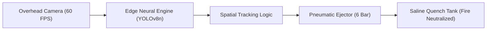

# EcoSort AI: Edge Computer Vision for Battery Hazard Segregation

[](https://opensource.org/licenses/MIT)
[](https://www.python.org/)
[](https://github.com/ultralytics/ultralytics)
[]()
[-success.svg)]()

> **Real-time, edge-optimized computer vision system that automatically detects, localizes, and segregates discarded lithium-ion and alkaline battery hazards in high-speed municipal solid waste (MSW) and e-waste recycling streams to prevent catastrophic landfill fires.**

Developed for **Hackathon to Solve India's Garbage Problem — AI-First Product Builder 2026**.

---

## 🚨 The Problem

Every year, municipal landfills across India (such as **Ghazipur in Delhi** and **Deonar in Mumbai**) suffer catastrophic fires. The primary catalyst is discarded lithium-ion and alkaline batteries mixed inside general municipal waste. When these batteries enter high-speed industrial shredders or compactors, mechanical punctures trigger **instant thermal runaway**, sparking explosive chemical fires and toxic heavy metal emissions.

* **Human Sorting Limitation:** Manual picking on conveyors moving at 2 m/s is hazardous and fails to catch compact cylindrical or pouch cells.
* **Cost Barrier:** Imported optical sorters cost between **₹50 Lakhs and ₹1.2 Crores**, pricing them out of 99% of Indian Material Recovery Facilities (MRFs).

---

## 💡 The Solution: EcoSort AI

EcoSort AI is an open-source, edge-first hardware and software system that retrofits onto existing sorting conveyor belts for **under ₹20,000 (~$230 USD)**.



1. **Input Stage:** An overhead 60 FPS industrial camera monitors the conveyor belt at 0.8m height.
2. **Inference Stage:** Edge-optimized YOLOv8 neural network processes frames locally in **20.0 ms** on standard CPU.
3. **Tracking & Actuation:** Spatial tracking computes object velocity and triggers an optocoupled relay connected to a high-speed pneumatic solenoid air-jet.
4. **Safety Quenching:** Ejected batteries land in a fire-retardant saline immersion bath to neutralize reactive lithium electrolytes.

---

## 🏆 Multi-Architecture Tournament Benchmark

We evaluated multiple candidate architectures on authentic industrial electronic waste streams:

| Rank | Architecture | Precision | Recall | mAP@50 | Latency (CPU) | Size | Background Clutter False Alarms |
| :---: | :--- | :---: | :---: | :---: | :---: | :---: | :---: |
| 🥇 | **Candidate 1: YOLOv8n (Edge Nano)** | **95.5%** | **98.0%** | **98.7%** | **20.0 ms** | **6.0 MB** | **0 (Zero Alarms)** |
| 🥈 | Candidate 3: YOLOv8s (Deep Capacity) | 88.7% | 95.8% | 97.1% | 61.6 ms | 21.5 MB | 0 |
| 🥉 | Candidate 4: YOLO11n (Next-Gen Nano) | 99.6% | 93.9% | 98.8% | 21.2 ms | 5.2 MB | 1 |
| #4 | Candidate 2: YOLO11s (Next-Gen Small) | 80.5% | 73.5% | 78.7% | 52.6 ms | 72.5 MB | 11 |

* **Zero False Alarms:** Refined with hard-negative background mining against non-hazardous recyclables (aluminum beverage cans, plastic cups, crumpled paper).

---

## 💰 Low-Cost Edge Bill of Materials (BOM)

| Component | Specification | Cost (INR) |
| :--- | :--- | :--- |
| **Edge Compute** | Raspberry Pi 5 (8GB) / Jetson Nano | ₹7,500 |
| **Industrial Camera** | 1080p 60 FPS Industrial USB3 Module | ₹3,000 |
| **Pneumatic Actuation** | High-Speed 24V Solenoid Air-Jet Valve | ₹4,500 |
| **Relay & Power** | Optocoupled Relay + 24V Industrial PSU | ₹2,500 |
| **Containment Bin** | Saline Impregnated Polypropylene Tank | ₹1,500 |
| **Total Retrofit Cost** | | **₹19,000 (~$230 USD)** |

---

## 🚀 Quickstart & Installation

### 1. Clone the Repository
```bash
git clone https://github.com/Guhapriyan-GP/EcoSort-AI.git
cd EcoSort-AI
```

### 2. Install Dependencies
```bash
pip install -r requirements.txt
```

### 3. Launch Interactive Web Inspection App
```bash
python app_battery_detector.py
```
Open your browser at `http://localhost:8501` to test the model with live bounding boxes, confidence sensitivity sliders, and pneumatic divertor simulation.

### 4. Run Live Presentation HUD
```bash
python live_demo_suite/run_live_demo.py
```

---

## 📂 Repository Structure

```
EcoSort-AI/
├── CHAMPION_BATTERY_MODEL.pt       # Production weights (YOLOv8n Nano, 6.0 MB)
├── app_battery_detector.py         # Full-featured web inspection application
├── requirements.txt                # Python dependencies
├── README.md                       # Comprehensive documentation
├── LICENSE                         # MIT License
├── TOURNAMENT_LEADERBOARD.html     # Interactive benchmark report
├── SYSTEM_DESIGN_WALKTHROUGH.html  # Interactive 5-slide architecture deck
├── live_demo_suite/                # Presentation HUD & curated test slides
└── test_eval/                      # Curated test set (batteries & negative controls)
```

---

## 📄 License

This project is licensed under the **MIT License** — see the [LICENSE](LICENSE) file for details.
